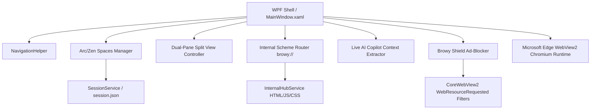

# Browy Architecture & System Design

Browy is an advanced Windows-native web browser built with WPF (.NET 9) and the Microsoft Edge WebView2 Chromium runtime.

## Core Architecture Overview

## Subsystems

### 1. Spaces & Tab Hierarchy (`BrowserSpace` & `BrowserTab`)
- **Spaces**: Arc/Zen-inspired isolated tab collections. Each space has an `Id`, `Name`, `IconGlyph`, `AccentColorHex`, and an independent `ObservableCollection<BrowserTab> Tabs`.
- **Active Tab Synchronization**: Switching spaces dynamically detaches the inactive space tabs from the visual tree and binds the new active space's tabs to the sidebar tab strip.
- **Persistence**: Sessions are preserved across browser restarts via `SessionService`, serialized to `%LocalAppData%/Browy/session.json`.

### 2. Dual-Pane Split View
- **Grid Layout**: `WebContentGrid` contains three columns: `PrimarySplitColumn`, `SplitViewSplitterColumn` (GridSplitter), and `SecondarySplitColumn`.
- **Split State**: Pressing `Ctrl+\` toggles split view. When enabled, a secondary tab is attached to column 2, allowing concurrent dual-page navigation with synchronized focus.

### 3. InPrivate Isolation
- **Stealth Architecture**: InPrivate windows create an ephemeral temporary folder (`%LocalAppData%/Browy/InPrivate_<Guid>`) passed to `CoreWebView2Environment.CreateAsync`.
- **Zero Disk Trace**: History recording, download tracking, and session saving are strictly disabled, and the temporary profile directory is purged upon window closure.

### 4. Browy Shield Ad-Blocker (`ShieldService`)
- **Network Interception**: Intercepts requests using `CoreWebView2.WebResourceRequested` with filter `*`.
- **Fast Domain & Regex Matching**: Blocks telemetry, analytics, ad servers, and tracking beacons using hashed lookup tables and URL heuristics, serving `204 No Content` responses to save bandwidth and improve page load latency.

### 5. Internal Scheme Protocol (`browy://*`)
- Custom schemes are intercepted during `NavigationStarting` and routed to internal fluent HTML renderers:
  - `browy://newtab` -> Fluent Start Page with speed dials, search bar, and clock.
  - `browy://history` -> Searchable browsing history with time grouping and deletion.
  - `browy://bookmarks` -> Grid of saved bookmarks with live filtering.
  - `browy://downloads` -> Download management center with open/show in folder controls.
  - `browy://settings` -> Global configuration for startup, search provider, shield, and keyboard shortcuts.
- **Bidirectional Bridge**: Internal pages communicate with WPF code-behind via `window.chrome.webview.postMessage(JSON.stringify({action: '...'}))`.

### 6. Live AI Copilot
- Activated via `Ctrl+J`.
- Extracts live DOM structure, page headings, and readable text via `ExecuteScriptAsync` from the active WebView2 tab.
- Synthesizes page summaries, concept explanations, and structured data tables based on actual viewport content.

## Testing Strategy
- Unit and integration tests reside in `tests/Browy.Tests/`.
- Tests run through `xUnit` and automated GitHub Actions CI on every commit and pull request.
